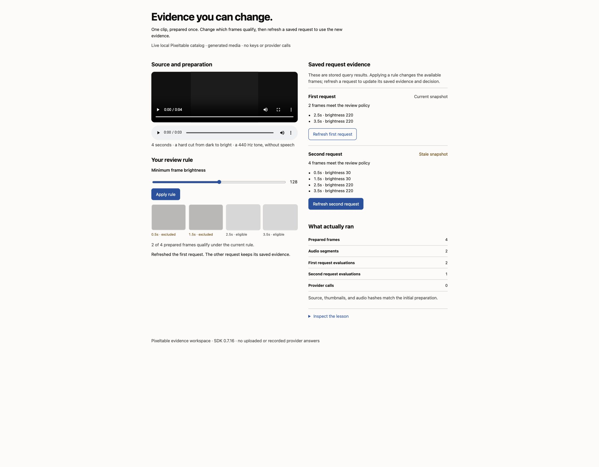

# Own your video pipeline with Pixeltable

[](https://github.com/pixeltable/showcase-video-orchestration-pipeline/actions/workflows/ci.yml)
[](LICENSE)
[](https://www.python.org/downloads/)

Keep your media, intermediate results, provider responses, and business logic in a [Pixeltable](https://github.com/pixeltable/pixeltable) catalog. Declare video-to-frame and video-to-audio transformations with the SDK, add model calls as computed columns, and inspect or reuse the evidence with ordinary queries.

Start with a local media review rule: prepare frames and audio once, reuse the frames for two requests, change the rule, and deliberately refresh one request. The SDK graph makes the data and each decision inspectable.

The optional benchmark records a Gemini 2.5 comparison: answer from the whole video (**static native**), or from keyframe captions, a transcript, and saved evidence (**orchestrated**). The same model writes both answers, with different perception and media settings. Local models, fal, and Bedrock are additional paths.

**Current comparison:** Gemini now supports [agentic video processing](https://ai.google.dev/gemini-api/docs/video-understanding), which makes the older native baseline incomplete for a new experiment. Agentic mode has **not been measured here**. The [updated comparison protocol](docs/AGENTIC_VIDEO_COMPARISON.md) compares current-model static, agentic, and application-owned evidence paths. Pixeltable's demonstrated value is durable media, inspectable transformations, reusable evidence, and explicit business rules and refresh timing.

**Validated SDK:** Pixeltable **0.7.16**, the latest stable PyPI release checked on 2026-10-10. The committed experiments used 0.7.11; upgrading the application does not turn those recordings into new experiments. A separate [live smoke record](docs/validation/2026-10-09.json) covers all five cloud paths on a generated four-second clip; it verifies execution and accounting, with an explicit transcription hallucination recorded.

**Paper:** [docs/paper/paper.md](docs/paper/paper.md) · **Showcase:** [docs/showcase.html](docs/showcase.html) · **Golden run:** [results/golden/](results/golden/) · **How it works:** [docs/WORKFLOW.md](docs/WORKFLOW.md)

## Explore the media workspace without keys

```bash
git clone https://github.com/pixeltable/showcase-video-orchestration-pipeline
cd showcase-video-orchestration-pipeline
python3.12 -m venv .venv && source .venv/bin/activate
pip install -e ".[workspace]"
run-evidence-workspace
```

Open the loopback URL printed at launch. Play the generated clip and audio, inspect the timestamped frames, set minimum brightness to **128**, and apply the rule. Both saved requests become stale. Refresh **first**: it uses two frames while **second** still uses four. Preparation remains four frames and two audio segments; the source and prepared-media hashes stay unchanged.



The workspace uses a real temporary Pixeltable catalog and makes no provider calls. Reloading reads the stored state. Ctrl-C stops the workspace and removes its owned catalog after database shutdown. It accepts no uploads and binds only to loopback. Follow the [walkthrough and source map](docs/WALKTHROUGH.md), including the [narrow view](docs/images/evidence-workspace-mobile.jpg), or run `run-media-demo` for the terminal-only lesson with the base install.

This generates a four-second clip, applies a real `TableModel` graph, and inserts one video row. Pixeltable extracts audio, emits four timestamped frames, resizes their thumbnails, and splits the audio into segments. A deterministic brightness rule selects frames for review; two request rows query the same prepared frames.

The demo changes the rule from accepting every frame to accepting only bright frames. Both requests retain their original four-frame evidence until the first request is explicitly refreshed; its result then uses two frames while the second still uses four. Look for `prepared_frames: 4`, `review_evaluations: ["first", "second", "first"]`, and `source_and_preparation_unchanged: true` in the output. The demo verifies source, thumbnail, and audio hashes before removing its temporary catalog. No download, credentials, or model call is needed.

The two operations that express the policy are ordinary SDK calls:

```python
clips.update({'minimum_brightness': 128.0}, where=clips.clip_id == 'demo')
requests.recompute_columns('evidence', where=requests.request_id == 'first')
```

Read the shared graph in [`local_graph.py`](src/video_benchmark/local_graph.py) and terminal assertions in [`local_demo.py`](src/video_benchmark/local_demo.py), then change the review rule. Query-backed evidence is a stored snapshot: the application decides when to refresh it.

## What you control

| Concern | Where it lives |
|---------|----------------|
| Media and intermediate data | Typed `Video`, `Image`, and `Audio` columns, iterator views, stored JSON responses |
| Transformations and business rules | Declared computed columns; frame selection and evidence formatting in [`evidence.py`](src/video_benchmark/evidence.py) |
| Model and API choices | Provider expressions in the graph; adapters for capabilities the built-ins do not expose |
| Reuse and refresh | The local demo shares frame preparation between requests; Video-MME shares captions and transcripts between questions. Refresh stored query results deliberately. |
| Failures | Per-cell errors, a bounded retry for transient failures, and explicit empty-output counts |
| Paid admission | Durable attempt reservations before supported model sends; explicit budget, attempt, duration, and output limits |
| Experiment identity | Definition digest, source and media hashes, package versions, and pinned annotation revision |

The local graph is in [`local_graph.py`](src/video_benchmark/local_graph.py); the optional benchmark graphs are in [`schema.py`](src/video_benchmark/schema.py) and [`videomme/schema.py`](src/video_benchmark/videomme/schema.py). Importing these modules declares functions; applying the models creates the catalog. Source rows are inserted before request rows so query-backed evidence is ready. See [workflow and extension points](docs/WORKFLOW.md), the [in-depth review](docs/REVIEW.md), and [deployment/recovery](docs/DEPLOYMENT.md).

## Check completion separately from quality

```bash
run-quality-checks
```

Six small labelled records cover a recorded tone-to-speech hallucination, an authored truthful description, refusal, missing audio, empty output, and invalid timestamps. The real October 9 synthesis completed but invented speech and a gradual fade; the checks flag both against the generated source. Other records are explicitly synthetic. These are narrow diagnostic rules, not a semantic evaluator or a new accuracy benchmark. Case hashes and installed versions accompany the output. [Quality boundaries](docs/WALKTHROUGH.md#check-the-quality-boundary) explain the labels and limitations.

## Recorded research results

On a 255-second interview clip (mean of six runs, list price, `gemini-2.5-flash` rates of 2026-09-28):

<!-- results:readme-clip:start -->

| Path | List price per answer | Clip phrase checks |
| --- | ---: | ---: |
| 1 Native | $0.0376 | 5/5 |
| 1L Native, low resolution | $0.0219 | 5/5 |
| 2 Orchestrated | $0.0308 | 5/5 |
| 4 fal video-understanding | $0.2400 | 2/5 |
| 5 Amazon Nova Pro | $0.0600 | 1/5 |

<!-- results:readme-clip:end -->

On 123 Video-MME questions (41 videos, 12.2 hours, three questions per video):

<!-- results:readme-videomme:start -->

| Path | Accuracy [95% CI] | List price per question | Response-accounted per question |
| --- | ---: | ---: | ---: |
| 1 Native | 79.7% [70.7, 87.8] | $0.107 | $0.061 |
| 1L Native, low resolution | 83.7% [74.8, 91.1] | $0.055 | $0.040 |
| 2 Orchestrated | 79.7% [71.5, 87.0] | $0.029 | $0.028 |
| 5 Amazon Nova Lite | 58.5% [50.4, 66.7] | $0.010 | $0.010 |

<!-- results:readme-videomme:end -->

Intervals resample whole videos; paired video-level tests do not resolve the Gemini differences on this sample (p >= 0.27). That does not establish equivalent accuracy. The sample comprises locally available Video-MME videos, and the five clip checks above are phrase heuristics, not a general quality score. Gemini refused both native settings on 2 of the 41 videos; the orchestrated path returned an answer for every question. Exports: [results/paper/](results/paper/).

“Billed” in historical exports means **response-accounted cost estimated from token usage after cache discounts**, not a reconciled invoice. Retried or interrupted calls without stored usage, provider refusals, local compute, storage, and egress can add unrecorded spend. Prices are a dated snapshot; see [cost boundaries](docs/WORKFLOW.md#cost-accounting).

In this recorded Gemini 2.5 experiment, orchestration traded video input ($0.30 per million tokens) for generated captions and transcript ($2.50 per million output tokens). Reusing preparation across three questions improved its measured economics; Gemini's implicit cache also discounted native input. These dated results do not predict the cost or quality of current agentic processing.

> **Correction.** An earlier version of this repository reported that orchestration cost 66% less than native ($0.039 vs $0.114). That figure came from a flat $1.50 per million token price, which overcharged video input fivefold, and from uncounted thinking tokens. Section 3 of the paper lists every correction.

## Run an optional provider comparison (Paths 1, 1L, 2)

```bash
cp .env.example .env       # set GOOGLE_API_KEY
run-benchmark --paths 1,1L,2 --preflight
run-benchmark --paths 1,1L,2 --budget-usd 1 --max-attempts 64
```

After the base installation above, this downloads the sample clip, builds the `video_benchmarking` catalog, and writes `results/<run_id>/`: `REPORT.md`, `summary.json` (answers, usage, and response-accounted cost), `keyframes.csv`, and `manifest.json` (config, prices, versions, source and media identities). The recorded default comparison was about $0.09 at the documented rates; new runs make paid API calls and their cost can vary.

Managed CLI runs reserve estimated cost **before every supported model send**, including retries and calls triggered during schema application. The default shared ledger is `results/provider-ledger.sqlite3`; pending or unknown attempts retain their reservations across restarts. Budget defaults to **$1**, attempts to **64 per invocation**, and media duration to **600 seconds**. Gemini and Nova output is capped at **4,096 tokens**, a changed experimental definition for future runs. Downloads and polling are not model attempts. Preflight may download media and checks configured credentials, not provider access; it makes no model calls or catalog changes.

The budget bounds admission using dated prices and conservative envelopes; it is **not an invoice ceiling**. An unknown attempt can coexist with more work while its held reservation fits the remaining budget. Fal records queue acceptance and a duration estimate; final polled output remains in the catalog. Unsupported model endpoints fail before send. Direct SDK calls outside these managed CLIs do not inherit the guard. Inspect the [attempt contract](docs/WALKTHROUGH.md#admit-paid-work-deliberately) before changing limits or recovering a run.

## Optional provider paths

| Path | Mechanism | Install |
|------|-----------|---------|
| `1` | `gemini.generate_content` on the video and the question | base |
| `1L` | Path 1 with `media_resolution=LOW` | base |
| `2` | Gemini caption per keyframe, Gemini transcript, scene-aware frame selection, one multimodal synthesis call | base |
| `3` | The same keyframes captioned by Qwen2.5-VL-3B, WhisperX transcript, Qwen2.5-7B synthesis, all local | `.[oss]` + `llama-cpp-python` |
| `4` | `fal.run` on `fal-ai/video-understanding` (first 120 s) | `.[fal]`, `FAL_KEY` |
| `5` | `bedrock.converse` with Amazon Nova; video that is not H.264 or exceeds the inline limit is re-encoded to the frames Nova samples | `.[bedrock]`, AWS credentials, `ffmpeg` |

```bash
run-benchmark --paths 1,2 --video my_clip.mp4 --query "What happens after the meeting?"
run-benchmark --paths 1,1L,2 --repeats 5          # five independent runs
run-benchmark --paths 3 --reset                   # a catalog is built for one path set
```

A benchmark catalog freezes paths, effective configuration, computation-source digest, and SDK version. Select paths with `--paths`; unused environment settings do not gate a run. Changing the frozen definition asks for `--reset`, which drops that benchmark catalog but keeps `results/`. Export runs before resetting. This is an experiment isolation policy; applications can instead use Pixeltable schema migration and selective recomputation.

## Video-MME

```bash
pip install -e ".[videomme]"
run-videomme --n 30 --paths 1,1L,2 --preflight  # sample/download; no model calls
run-videomme --local-only --n 123 --paths 1,1L,2,5 --preflight
```

The small default admission limits can reject or stop a full research run. Inspect the sample manifest and duration first, then supply a deliberately chosen budget, attempt limit, and media-duration limit. A paired rerun must preserve exact question/media identities and effective settings; the same count and seed are insufficient. [Research contribution checks](docs/WALKTHROUGH.md#make-a-research-change-reviewable) define the required evidence.

Questions share their video's captions and transcript, so orchestration prepares evidence once per video. `run-videomme` checks all proposed input identities before inserting any rows: an existing ID with changed media bytes, annotation revision, question, options, or answer is rejected. Identical inputs resume without new calls; adding a question to the same video runs only its answer stage. Interrupted calls that did not commit can be repeated. Persisted failures need explicit recomputation; see [failure recovery](docs/WORKFLOW.md#failures-and-changes). Exports include clustered accuracy and difference intervals, paired video-level tests, costs, predictions, and identities saved when inputs were accepted. Annotation revision is pinned in [`sample.py`](src/video_benchmark/videomme/sample.py).

## Benchmark settings

| Variable | Default | Effect |
|----------|---------|--------|
| `GEMINI_MODEL` | `gemini-2.5-flash` | Model for Paths 1, 1L, 2; must have a price in [`pricing.py`](src/video_benchmark/pricing.py) |
| `VISION_SAMPLE_KEYFRAMES` | 24 | Frames sampled evenly for captions |
| `FRAME_SELECT_BUDGET` | 16 | Frames kept for synthesis, nearest to scene cuts and spread over the timeline |
| `GEMINI_SYNTH_MAX_IMAGES` | 8 | Kept frames attached as images to the synthesis call |
| `OSS_ASR` | `whisperx` | Path 3 transcript: `whisperx` (needs `HF_TOKEN`), `whisper`, or `gemini` |
| `NOVA_MODEL_ID` | `amazon.nova-pro-v1:0` | Path 5 model (Video-MME defaults to Nova Lite) |

Prompts live in [`prompts.py`](src/video_benchmark/prompts.py) and [`videomme/prompts.py`](src/video_benchmark/videomme/prompts.py); every path that writes an answer shares the same question and guidance.

## Inspect a run

```bash
pxt ls video_benchmarking
pxt rows video_benchmarking/keyframes -n 5 --cols position_sec,gemini_caption,gemini_caption_cost
pxt rows video_benchmarking/syntheses -n 1 --cols gemini_prompt,gemini_answer,gemini_total_cost
```

[`notebooks/pipeline_analytics.ipynb`](notebooks/pipeline_analytics.ipynb) walks one run through every stage (`./scripts/notebook.sh`). Run it while no benchmark is running: a new Pixeltable process clears the catalog's temporary files.

## Layout

```
src/video_benchmark/
  schema.py        Pursuit catalog: runs, keyframes, audio_chunks, syntheses
  local_graph.py   provider-free preparation, policy, and stored request evidence
  workspace.py     loopback browser workspace over that same graph
  admission.py     managed CLI attempt ledger and transport guards
  quality.py       small labelled completion/correctness boundary checks
  pricing.py       rates and cost from usage metadata
  prompts.py       shared answer instructions
  evidence.py      transcript parsing, frame selection, synthesis request
  providers.py     calls Pixeltable does not wrap as needed (transcript with usage, fal upload)
  oss.py           Path 3 local models
  videomme/        Video-MME catalog: videos, keyframes, audio_chunks, questions
docs/paper/        paper, figures, numbers.json
results/golden/    committed all-paths run
results/paper/     the exports the paper cites
```

## Development

```bash
pip install -e ".[dev,workspace,fal]"
pytest                       # offline: a fake Gemini client and a generated test video
ruff check src tests scripts
python scripts/schema_apply_smoke.py
python -m video_benchmark.local_demo
python -m video_benchmark.quality
```

The Pixeltable release is the `pixeltable==` pin in [`pyproject.toml`](pyproject.toml). [CI](.github/workflows/ci.yml) checks the pin, lint, offline provider tests, CLI help, repeated isolated schema application, a real local media graph, and showcase rendering. [Upgrade watch](.github/workflows/upgrade-watch.yml) tests newer releases with their dependencies and fails with a pin-bump notice when they pass. [Dependabot](.github/dependabot.yml) updates GitHub Actions.

To rebuild the paper: install `.[paper]`, then run `python scripts/build_paper_figures.py`, `python scripts/render_paper_tables.py`, and `./scripts/build_paper.sh` (needs `pandoc` and `tectonic`). The repeated README and paper result tables come from `docs/paper/numbers.json`; `python scripts/render_paper_tables.py --check` detects drift without writing. Reanalysis reads the committed exports and makes no provider calls.

## License

Apache-2.0. Sample video from the [Pixeltable docs](https://github.com/pixeltable/pixeltable/blob/main/docs/resources/The-Pursuit-of-Happiness.mp4). Video-MME annotations: academic use only.
