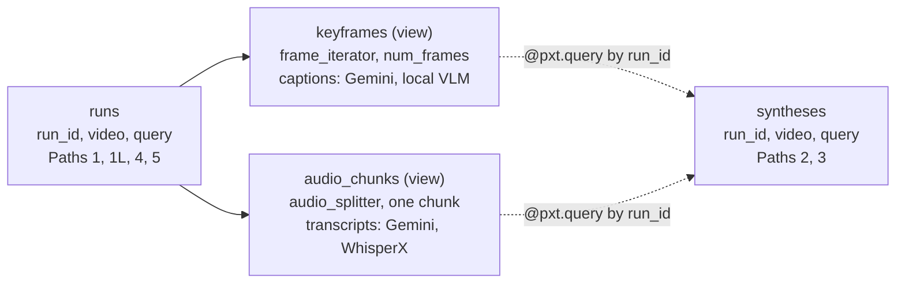
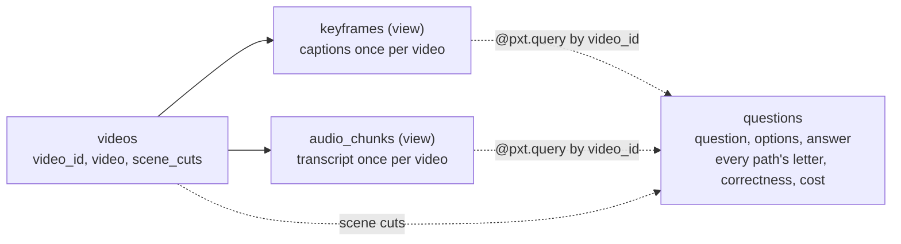

# Workflow

Own the source media, preparation, and decision rules in a Pixeltable `TableModel` graph. Insert a row and computed columns derive typed outputs; request rows can query stored preparation instead of running it again.

## Local ownership lesson

Run `run-media-demo`. It generates a four-second clip, extracts audio, splits it into two segments, and creates four timestamped thumbnails. A local UDF measures each frame's brightness once. A computed eligibility column applies a threshold stored on the clip, while two request rows materialize queries of eligible frames.

| Operation | Eligible frames | First request snapshot | Second request snapshot | Frame preparations |
|-----------|----------------:|-----------------------:|------------------------:|-------------------:|
| Insert clip and two requests, threshold 0 | 4 | 4 | 4 | 4 |
| Update threshold to 128 | 2 | 4 | 4 | 4 |
| Recompute first request's evidence | 2 | 2 | 4 | 4 |

The assertions verify the unchanged source bytes, thumbnail contents, audio segment contents, and preparation call count. Only the first request's evidence and downstream decision refresh. The second snapshot remains available for inspection. The catalog is temporary and no provider is called. The shared graph is in [`local_graph.py`](../src/video_benchmark/local_graph.py), its terminal assertions in [`local_demo.py`](../src/video_benchmark/local_demo.py), and its deterministic UDFs in [`local_demo_rules.py`](../src/video_benchmark/local_demo_rules.py). Install `.[workspace]` and run `run-evidence-workspace` to inspect the same graph in a browser. Follow the [interactive walkthrough](WALKTHROUGH.md).

Business logic and refresh timing are application choices. A computed column's ordinary dependencies update with their source; a query-backed lookup of another table is a stored snapshot and requires deliberate refresh.

## Optional provider and research graphs

Each benchmark path answers the same question about the same video. The benchmark graphs extend the local SDK pattern with response JSON, usage, evidence selection, and answer columns. They live in one frozen catalog per benchmark, applied with a single `update_all()`. Importing schema modules does not mutate the catalog. Select paths with `--paths`; the older `--skip-*` switches remain compatibility aliases. Configuration validates effective selected settings: unused frame/local-model knobs and credential-disabled Nova settings cannot block a native run. Video-MME Path 3 uses Gemini ASR and therefore requires a valid Gemini model and credentials.

| Path | Mechanism | Model calls per video | Cost column |
|------|-----------|-----------------------|-------------|
| 1 | Whole video + question, one call | 1 | `native_cost` |
| 1L | Path 1 at `media_resolution=LOW` (about 66 instead of 258 tokens per frame) | 1 | `native_low_cost` |
| 2 | Keyframe captions + transcript, then one multimodal synthesis call | 24 captions, 1 transcript, 1 synthesis | `gemini_total_cost` |
| 3 | The same keyframes captioned by a local VLM, local ASR, local synthesis | 0 API calls | `oss_cost` |
| 4 | fal `video-understanding` on the first 120 s | 1 | `fal_cost` |
| 5 | Amazon Nova on Bedrock (inline H.264 video under 18 MB, re-encoded when needed) | 1 | `nova_cost` |

Paths 1, 1L, and 2 use the same Gemini model, with different media and perception settings. They use `generateContent`; no path currently calls Interactions or enables agentic video processing. The [current comparison protocol](AGENTIC_VIDEO_COMPARISON.md) separates processing-mode effects from model upgrades and evidence architecture.

## The Pursuit catalog (`video_benchmarking`)



`run-benchmark` inserts one `runs` row, which fills the views, then one `syntheses` row whose columns query those views by `run_id`. The synthesis request therefore sees finished captions and transcripts before its intended answer call, subject to the retry policy below. Columns exist only for the selected paths, so an unselected path never spends.

Stages of Path 2, each a column you can read:

| Table | Column | Content |
|-------|--------|---------|
| `keyframes` | `gemini_caption_response`, `gemini_caption`, `gemini_caption_usage`, `gemini_caption_cost` | One caption call per sampled frame, thinking disabled |
| `audio_chunks` | `gemini_asr_response`, `gemini_transcript`, `gemini_asr_usage`, `gemini_asr_cost` | Diarized transcript of the whole audio track, thinking disabled |
| `syntheses` | `gemini_frames`, `gemini_transcript` | The run's captions and transcript lines |
| `syntheses` | `gemini_selected`, `gemini_attached` | Frames kept near scene cuts (`FRAME_SELECT_BUDGET`), and the subset attached as images (`GEMINI_SYNTH_MAX_IMAGES`) |
| `syntheses` | `gemini_prompt`, `gemini_contents` | The exact synthesis request |
| `syntheses` | `gemini_response`, `gemini_answer`, `gemini_synthesis_cost`, `gemini_total_cost` | The answer, and captions + transcript + synthesis cost |

```bash
pxt ls video_benchmarking
pxt rows video_benchmarking/keyframes -n 5 --cols position_sec,gemini_caption,gemini_caption_cost
pxt rows video_benchmarking/syntheses -n 1 --cols gemini_prompt,gemini_answer,gemini_total_cost
```

## The Video-MME catalog (`videomme`)



Captions and the transcript are computed once per video and reused by that video's questions; only the answer call is per question. Video-MME captions are query-agnostic; Pursuit captions are conditioned on the run's question. The export splits each video's evidence cost (`orch_shared_cost`) evenly across its questions in the exported sample. `run-videomme` inserts missing rows, one video or six questions per insert. Completed batches survive interruption, and rerunning identical rows makes no new calls. A paid call interrupted before its insert commits can run again without its earlier usage being recorded.

Every invocation preflights all proposed video and question identities before inserting either table. Accepted rows store the annotation revision, canonical input SHA-256, and the video's original bytes SHA-256 and size. Reusing an ID with different media, revision, question, options, answer, or video link is rejected; replacing bytes at the same path also conflicts. Another path to identical bytes is accepted. A new question for an unchanged video runs only answer stages. An existing row without a saved identity cannot be treated as identical. The frozen Video-MME definition also includes the annotation revision. These safeguards require rebuilding older catalogs after exporting their runs; they do not rewrite old results.

## Cost accounting

Managed comparison CLIs additionally commit durable reservations before supported model
transport sends, including retries and schema-triggered computation. Their default shared
ledger, budget/attempt/media limits, unknown holds, endpoint restrictions, and verification
boundaries are documented in the [attempt contract](WALKTHROUGH.md#admit-paid-work-deliberately).
This is estimated admission, not an invoice ceiling. Output is capped at 4,096 tokens for
new Gemini/Nova runs; this changes the experimental definition from the historical exports.

Cost is computed from the token counts each response reports, never from text length:

- Gemini: input tokens by modality (`prompt_tokens_details`: text, image, video, audio), cached input at the cache rate, and output tokens plus thinking tokens (`thoughts_token_count`) at the output rate.
- Nova: Bedrock `usage.inputTokens` and `usage.outputTokens`.
- fal: $0.01 per started 5 s of the trimmed clip (the published rate; the API reports no usage).

Rates live in [`src/video_benchmark/pricing.py`](../src/video_benchmark/pricing.py) with their snapshot date. Where responses contain usage, it is stored next to cost so it can be re-priced without another model call. Models must have a known rate before their costs can be computed.

These are **response-accounted estimates**, not invoice totals. Historical fields named `billed`/`cost_usd` apply cached-input discounts to returned usage. Retries, interruption before commit, SDK parsing failures, and missing usage can leave paid attempts unrecorded. Local GPU/CPU time, storage, download/egress, taxes, and service charges are excluded. fal is a duration-based estimate because it supplies no token usage. A missing usage response or ambiguous mixed-modality cache allocation produces an accounting error and `null` cost; it is never called free. New reports count unknown-cost questions separately and expose known partial subtotals as `response_accounted_cost_usd`.

The shared accounting policy keeps complete totals nullable while retaining every known response cost, including when another stage or answer has unknown usage. Pursuit exports carry `response_accounted_cost_usd` and `response_accounted_list_cost_usd`. Video-MME predictions carry `p*_response_accounted_cost` and `p*_response_accounted_list_cost`; their summaries use the same `*_usd` fields as Pursuit. Known shared preparation is divided across that video's questions in the current export, so summing predictions accounts for it once. Per-video records distinguish nullable stage totals from known recorded subtotals. Archived exports without the new subtotal fields fall back to their recorded complete costs; no old export is repriced or rewritten by this change. Reports label a partial subtotal explicitly and keep the complete total unknown.

All accuracy and accuracy-difference intervals resample entire videos. Paired tests exchange each video's path labels together, preserving dependence among its questions; their p-values are exploratory and unadjusted. Question-level Wilson intervals and McNemar p-values remain labeled diagnostics. Percentile bootstrap intervals can collapse at all-right/all-wrong boundaries on small strata; they do not establish certainty. Missing answers count as wrong on every attempted question. The saved benchmark is a local availability sample and has no equivalence-test design.

## Fairness rules

- The answer-writing call of every path gets the same question and the same answer guidance ([`prompts.py`](../src/video_benchmark/prompts.py)); only the evidence differs.
- Paths 2 and 3 caption the same sampled frames and select the same subset.
- Perception calls (captions, transcription) run without thinking; answer-writing calls use the model's default thinking.
- Path 1L is the lower-cost native setting tested in the historical Gemini 2.5 experiment. A current-model comparison also needs an agentic baseline; low resolution alone is insufficient.

## Failures and changes

- Inserts use `on_error='ignore'`: errors are stored on cells (`<column>.errortype` / `.errormsg`) and other paths continue. Transient failures get one retry scoped to their inserted batch. Type, value, import, and dependency setup failures are preserved for inspection; deterministic parsing errors do not trigger another paid model call.
- A failed caption carries no evidence; synthesis runs on the remaining evidence and reports the failure. Missing response usage is unknown cost, not proof that an attempt was unbilled.
- A call can also succeed with no text: Gemini stops a transcript that would recite copyrighted audio (`finish_reason` `RECITATION`) without raising an error, and the tokens are still billed. Exports count these as `empty_outputs` (Pursuit stages) and `<stage>_empty` (Video-MME `videos.jsonl`, and the evidence lines of `REPORT.md`).
- On Pixeltable 0.7.15 and 0.7.16 a Gemini response with `candidates=None` still raises `'NoneType' object is not iterable` inside the built-in wrapper. The full refusal response and any usage are lost before storage; reports retain the cell error and unknown cost. The offline suite reproduces this SDK limitation. The application does not automatically repeat this deterministic failure to discover its block reason.
- Catalog definitions include a digest of computation source, configuration, selected paths, and SDK version. This catches edits to UDF bodies that an expression-only schema diff can miss. A mismatch asks for `--reset`, which drops that benchmark catalog and keeps exports. Existing pre-upgrade catalogs also require rebuilding; export first.
- Resuming skips already inserted rows, including persisted failures. After correcting a provider issue, use the table's `recompute_columns('<response>', errors_only=True, where=...)` deliberately; it may make paid calls. Synthesis queries are materialized lookups of another table: after updating captions/transcripts, explicitly recompute the request's evidence query columns and downstream synthesis. They are not a live join.
- Silent video has no extracted audio; Pixeltable skips non-nullable audio calls. An empty transcript also can mean recitation, refusal, or a failed stage. Inspect responses and stage counters before interpreting `[no speech detected]` as evidence of silence.

## Extend the graph

| Change | Starting point | Validation |
|--------|----------------|------------|
| Add a media transform | Declare a computed column or iterator view; check `pixeltable.functions.video`, `.audio`, and `.image` first | Run the local media demo and inspect typed outputs |
| Change a model/API | Replace its expression in `schema.py`; keep response and usage columns alongside the answer | Add a price entry and fake response fixture; start a new benchmark catalog |
| Change business logic | Edit frame selection, transcript parsing, or prompts as versioned source | Test the affected transform and record the new definition digest |
| Reuse evidence | Store query-agnostic preparation per video and query it from request rows, as Video-MME does | Verify multiple questions make one set of preparation calls |

Benchmark reset rules freeze experiments. For a continuously running application, use Pixeltable schema migration and selective recomputation with an explicit policy for refreshing materialized query results. This repository is a local SDK and research showcase; authentication, upload quotas, background job admission, deployment, and invoice reconciliation are outside its validated scope.

## Fresh research comparisons

Start with the [agentic video comparison protocol](AGENTIC_VIDEO_COMPARISON.md). Its proposed arms are not CLI paths. Interactions model POSTs fail closed in managed runs until their admission, lifecycle, and usage accounting are supported. A model-name substitution cannot reproduce that experiment.

A paired rerun must retain the original question IDs and video bytes from the published exports, then use a new Pixeltable home and export directory. Sampling again with the same question count and seed is insufficient: the historical 123-question sample has 30 short, 51 medium, and 42 long questions, whereas the current sampler uses equal duration quotas. A different sample answers a different research question. Preserve historical artifacts and compare only compatible runs. The October 9 cloud smoke check is a four-second transport/accounting check, not a rerun of those published results.
