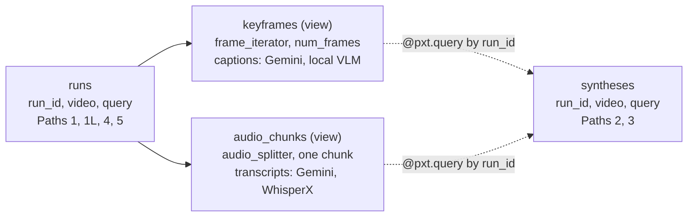
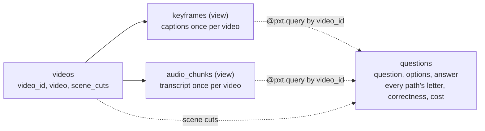

# Workflow

Every path answers the same question about the same video. The paths live in one Pixeltable catalog per benchmark, declared as a `TableModel` graph and applied with a single `update_all()`. Each stage is a computed column: insert a row and Pixeltable runs the stages, stores every intermediate result, and records failed calls per cell.

Start with `run-media-demo` for a generated local clip and real video, image, and audio transforms without provider calls. The benchmark graphs extend that same SDK model with response JSON, usage, evidence selection, and answer columns. Importing schema modules does not mutate the catalog.

| Path | Mechanism | Model calls per video | Cost column |
|------|-----------|-----------------------|-------------|
| 1 | Whole video + question, one call | 1 | `native_cost` |
| 1L | Path 1 at `media_resolution=LOW` (about 66 instead of 258 tokens per frame) | 1 | `native_low_cost` |
| 2 | Keyframe captions + transcript, then one multimodal synthesis call | 24 captions, 1 transcript, 1 synthesis | `gemini_total_cost` |
| 3 | The same keyframes captioned by a local VLM, local ASR, local synthesis | 0 API calls | `oss_cost` |
| 4 | fal `video-understanding` on the first 120 s | 1 | `fal_cost` |
| 5 | Amazon Nova on Bedrock (inline H.264 video under 18 MB, re-encoded when needed) | 1 | `nova_cost` |

Paths 1, 1L, and 2 use the same Gemini model, so their differences come from the architecture alone.

## The Pursuit catalog (`video_benchmarking`)



`run-benchmark` inserts one `runs` row, which fills the views, then one `syntheses` row whose columns query those views by `run_id`. The synthesis request therefore sees finished captions and transcripts before its intended answer call, subject to the retry policy below. Columns exist only for the selected paths, so an unselected path never spends.

Stages of Path 2, each a column you can read:

| Table | Column | Content |
|-------|--------|---------|
| `keyframes` | `gemini_caption_response`, `gemini_caption`, `gemini_caption_usage`, `gemini_caption_cost` | One caption call per sampled frame, thinking disabled |
| `audio_chunks` | `gemini_asr_response`, `gemini_transcript`, `gemini_asr_usage`, `gemini_asr_cost` | Diarized transcript of the whole audio track, thinking disabled |
| `syntheses` | `gemini_frames`, `gemini_transcript` | The run's captions and transcript lines |
| `syntheses` | `gemini_selected`, `gemini_attached` | Frames kept near scene cuts (`FRAME_SELECT_BUDGET`), and the subset attached as images (`GEMINI_SYNTH_MAX_IMAGES`) |
| `syntheses` | `gemini_prompt`, `gemini_contents` | The exact synthesis request |
| `syntheses` | `gemini_response`, `gemini_answer`, `gemini_synthesis_cost`, `gemini_total_cost` | The answer, and captions + transcript + synthesis cost |

```bash
pxt ls video_benchmarking
pxt rows video_benchmarking/keyframes -n 5 --cols position_sec,gemini_caption,gemini_caption_cost
pxt rows video_benchmarking/syntheses -n 1 --cols gemini_prompt,gemini_answer,gemini_total_cost
```

## The Video-MME catalog (`videomme`)



Captions and the transcript are computed once per video and reused by that video's questions; only the answer call is per question. Video-MME captions are query-agnostic; Pursuit captions are conditioned on the run's question. The export splits each video's evidence cost (`orch_shared_cost`) evenly across its questions in the exported sample. `run-videomme` inserts missing rows, one video or six questions per insert. Completed batches survive interruption, and rerunning identical rows makes no new calls. A paid call interrupted before its insert commits can run again without its earlier usage being recorded.

## Cost accounting

Cost is computed from the token counts each response reports, never from text length:

- Gemini: input tokens by modality (`prompt_tokens_details`: text, image, video, audio), cached input at the cache rate, and output tokens plus thinking tokens (`thoughts_token_count`) at the output rate.
- Nova: Bedrock `usage.inputTokens` and `usage.outputTokens`.
- fal: $0.01 per started 5 s of the trimmed clip (the published rate; the API reports no usage).

Rates live in [`src/video_benchmark/pricing.py`](../src/video_benchmark/pricing.py) with their snapshot date. Where responses contain usage, it is stored next to cost so it can be re-priced without another model call. Models must have a known rate before their costs can be computed.

These are **response-accounted estimates**, not invoice totals. Historical fields named `billed`/`cost_usd` apply cached-input discounts to returned usage. Retries, interruption before commit, SDK parsing failures, and missing usage can leave paid attempts unrecorded. Local GPU/CPU time, storage, download/egress, taxes, and service charges are excluded. fal is a duration-based estimate because it supplies no token usage. A missing usage response or ambiguous mixed-modality cache allocation produces an accounting error and `null` cost; it is never called free. New reports count unknown-cost questions separately and expose known partial subtotals as `response_accounted_cost_usd`.

All accuracy and accuracy-difference intervals resample entire videos. Paired tests exchange each video's path labels together, preserving dependence among its questions; their p-values are exploratory and unadjusted. Question-level Wilson intervals and McNemar p-values remain labeled diagnostics. Percentile bootstrap intervals can collapse at all-right/all-wrong boundaries on small strata; they do not establish certainty. Missing answers count as wrong on every attempted question. The saved benchmark is a local availability sample and has no equivalence-test design.

## Fairness rules

- The answer-writing call of every path gets the same question and the same answer guidance ([`prompts.py`](../src/video_benchmark/prompts.py)); only the evidence differs.
- Paths 2 and 3 caption the same sampled frames and select the same subset.
- Perception calls (captions, transcription) run without thinking; answer-writing calls use the model's default thinking.
- Path 1L is the cost-optimized native baseline, so orchestration is not compared only against an unoptimized native call.

## Failures and changes

- Inserts use `on_error='ignore'`: errors are stored on cells (`<column>.errortype` / `.errormsg`) and other paths continue. Transient failures get one retry scoped to their inserted batch. Type, value, import, and dependency setup failures are preserved for inspection; deterministic parsing errors do not trigger another paid model call.
- A failed caption carries no evidence; synthesis runs on the remaining evidence and reports the failure. Missing response usage is unknown cost, not proof that an attempt was unbilled.
- A call can also succeed with no text: Gemini stops a transcript that would recite copyrighted audio (`finish_reason` `RECITATION`) without raising an error, and the tokens are still billed. Exports count these as `empty_outputs` (Pursuit stages) and `<stage>_empty` (Video-MME `videos.jsonl`, and the evidence lines of `REPORT.md`).
- On Pixeltable 0.7.15 a Gemini response with `candidates=None` still raises `'NoneType' object is not iterable` inside the built-in wrapper. The full refusal response and any usage are lost before storage; reports retain the cell error and unknown cost. The offline suite reproduces this SDK limitation. The application does not automatically repeat this deterministic failure to discover its block reason.
- Catalog definitions include a digest of computation source, configuration, selected paths, and SDK version. This catches edits to UDF bodies that an expression-only schema diff can miss. A mismatch asks for `--reset`, which drops that benchmark catalog and keeps exports. Existing pre-upgrade catalogs also require rebuilding; export first.
- Resuming skips already inserted rows, including persisted failures. After correcting a provider issue, use the table's `recompute_columns('<response>', errors_only=True, where=...)` deliberately; it may make paid calls. Synthesis queries are materialized lookups of another table: after updating captions/transcripts, explicitly recompute the request's evidence query columns and downstream synthesis. They are not a live join.
- Silent video has no extracted audio; Pixeltable skips non-nullable audio calls. An empty transcript also can mean recitation, refusal, or a failed stage. Inspect responses and stage counters before interpreting `[no speech detected]` as evidence of silence.

## Extend the graph

| Change | Starting point | Validation |
|--------|----------------|------------|
| Add a media transform | Declare a computed column or iterator view; check `pixeltable.functions.video`, `.audio`, and `.image` first | Run the local media demo and inspect typed outputs |
| Change a model/API | Replace its expression in `schema.py`; keep response and usage columns alongside the answer | Add a price entry and fake response fixture; start a new benchmark catalog |
| Change business logic | Edit frame selection, transcript parsing, or prompts as versioned source | Test the affected transform and record the new definition digest |
| Reuse evidence | Store query-agnostic preparation per video and query it from request rows, as Video-MME does | Verify multiple questions make one set of preparation calls |

Benchmark reset rules freeze experiments. For a continuously running application, use Pixeltable schema migration and selective recomputation with an explicit policy for refreshing materialized query results. This repository is a local SDK and research showcase; authentication, upload quotas, background job admission, deployment, and invoice reconciliation are outside its validated scope.
