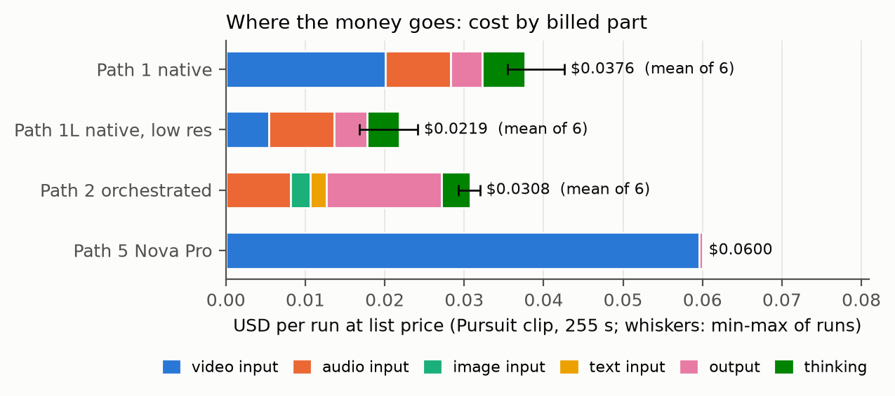
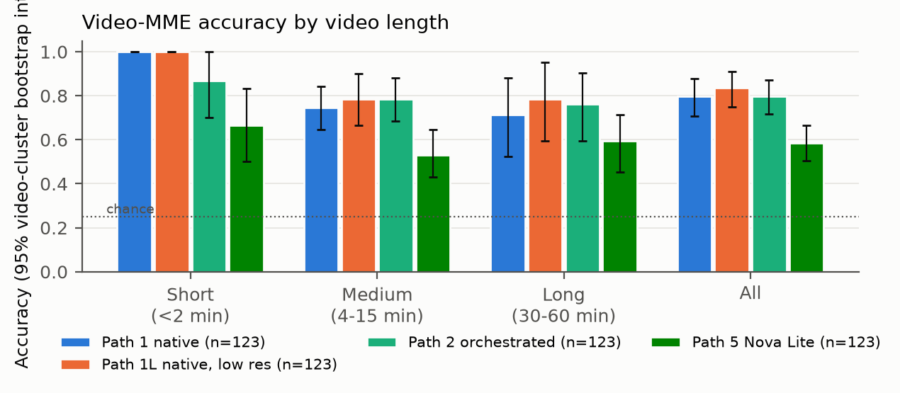
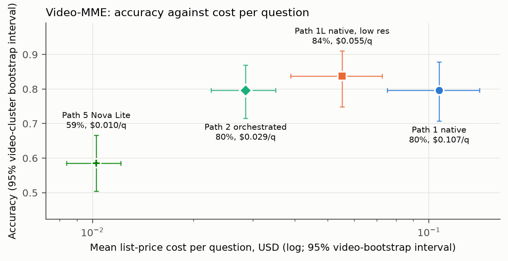
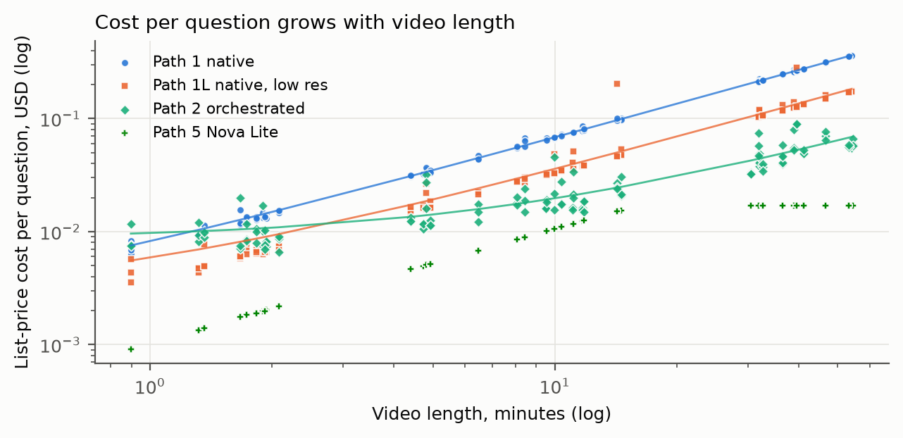

# Abstract

There are two ways to answer a question about a video with a multimodal model: send the whole video in one call (native), or caption sampled keyframes, transcribe the audio, and answer from that evidence with a second call (orchestrated). An earlier version of this benchmark reported that orchestration with Gemini 2.5 Flash cost 66% less than native. That figure came from a flat per-token price that overcharged video input fivefold, undercharged output, and ignored thinking tokens. We re-measure with the token counts each response reports, per modality, including thinking and cached tokens; identical answer instructions for every path; a cost-optimized native baseline at low media resolution; six repeated runs on a 255-second narrative clip; and 123 Video-MME questions from 41 videos with paired tests. On the clip, at list price, native costs \$0.0376 per answer, orchestration \$0.0308 (18% less), and native at low media resolution \$0.0219 (29% less than orchestration); all three pass the five clip-specific phrase checks. On Video-MME, native and orchestration each answer 79.7% of questions and native at low media resolution 83.7%, with no resolved difference in exploratory paired video-level tests, at list prices of \$0.107, \$0.029, and \$0.055 per question; Gemini's implicit cache, which serves repeated native calls about the same video, brings the response-accounted estimates to \$0.061, \$0.028, and \$0.040. Gemini refused native calls on 2 of 41 videos; the orchestrated path answered every question. The cost structure explains the result: orchestration replaces video input tokens, billed at \$0.30 per million, with generated captions and transcript, billed at \$2.50 per million. It pays off when that evidence is reused across several questions about the same video. The benchmark is a Pixeltable catalog in which every stage is a stored computed column; the declarative graph also removed two accounting bugs of the imperative version, a paid synthesis call on empty evidence and evidence shared across runs.

# 1 Introduction

A multimodal model that accepts video can answer a question about a clip in one call. A modular pipeline can answer the same question from sparse keyframes and a transcript, and industry practice still relies on such pipelines for cost and control [@peng2026qca; @tang2025aks; @shlapentokh2026toolmerge]. The choice between them is usually argued from token counts: a native call pays for every second of video, while a pipeline pays for a few dozen frames. That argument is incomplete, because the providers price input and output tokens differently, price modalities differently, and bill a model's hidden reasoning as output.

We compare the two architectures with the same model, Gemini 2.5 Flash [@comanici2025gemini25], so that differences in cost and accuracy come from the architecture alone. We measure cost from the usage metadata each response reports, and we add a native baseline that uses the API's own cost control, low media resolution, so orchestration is not compared only against an unoptimized native call.

This paper makes five contributions:

1. **Token-accounted cost.** Every call's cost is computed from its reported tokens per modality, with thinking tokens billed as output and implicitly cached tokens at the cache rate. We report response-accounted cost estimates and list estimates (the same tokens without cache discounts), because the cache discount varies between identical runs.
2. **A fair protocol.** Every answer-writing call receives the same question and answer guidance; the orchestrated paths differ from native only in the evidence they see. Perception calls run without thinking.
3. **A cost model** that predicts each path's cost from video length and number of questions, fitted from measured token rates.
4. **Measurements** on a narrative clip (six runs per path) and on 123 Video-MME questions [@fu2025videomme], with paired significance tests that account for questions sharing a video.
5. **A correction** of this benchmark's earlier claims, with the cause of each error.

The implementation is a Pixeltable catalog [@pixeltable]. Each successful stage (caption, transcript, synthesis request, response, and returned usage) is a stored column that can be read back, which is what made the accounting errors of the earlier version visible.

# 2 Related work

**Native multimodal models.** Early-fusion models process visual and text tokens in one transformer; scaling studies find no inherent disadvantage relative to late fusion and better efficiency at small scale [@shukor2025scaling], and a recent survey organizes native models by input and output modality [@an2026roadmap]. Gemini 2.5 accepts hour-long video with audio in one request [@comanici2025gemini25].

**Keyframe selection.** Long-video systems reduce cost by choosing informative frames: adaptive sampling [@tang2025aks], query- and content-aware budgets [@peng2026qca], and tool-based retrieval that decomposes the question [@shlapentokh2026toolmerge]. Our orchestrated path uses a simpler rule (even sampling, then frames nearest to scene cuts, spread over the timeline); we measure whether even that rule is cost-competitive.

**Evaluation.** Video-MME provides multiple-choice questions over short, medium, and long videos [@fu2025videomme]; VideoOdyssey stresses ultra-long, continuous reasoning where sparse frames are expected to fail [@he2026videoodyssey]. Published comparisons of video models rarely report cost at the token level; this paper does.

# 3 Correction to earlier results

The previous version of this benchmark (repository release of July 2026) reported the numbers in the left column of Table 1. Three errors produced them:

1. **Price.** All Gemini tokens were billed at \$1.50 per million. Gemini 2.5 Flash bills text, image, and video input at \$0.30, audio input at \$1.00, and output at \$2.50 per million [@geminipricing]. Native calls are dominated by video input and were overcharged about fivefold; orchestration is dominated by generated text and was undercharged.
2. **Thinking tokens.** Output cost counted only `candidatesTokenCount`. Gemini 2.5 Flash also bills `thoughtsTokenCount`, which was up to 3,224 tokens per native call in our runs.
3. **Unfair instructions.** The synthesis prompt of the orchestrated path asked for quoted turning points and full coverage through the last timestamp, which the scored beats reward; the native prompt did not. With identical instructions, every path recovers every beat (Section 7.2).

Two implementation bugs also affected spend without affecting the reported numbers: the orchestrated synthesis ran once at insert time on empty evidence and again after a recompute, so each run paid for two syntheses and reported one; and evidence was gathered by query text rather than by run, so repeated runs mixed each other's frames and transcripts. The Video-MME slice asked 30 questions from 12 videos, too few to separate its two accuracies.

| Measurement | Earlier version | This paper |
|--------------------------------------------------------------|-------------:|-------------:|
| Pursuit, Path 1 native | \$0.114 | \$0.0376 |
| Pursuit, Path 2 orchestrated | \$0.039 | \$0.0308 |
| Pursuit, orchestration saving vs native | 66% | 18% |
| Pursuit, Path 1L native low resolution | not measured | \$0.0219 |
| Video-MME, same 30 questions: native / orchestrated accuracy | 80% / 67% | 87% / 73% (low resolution 83%) |
| Video-MME, same 30 questions: native / orchestrated total cost | \$14.31 / \$1.15 | \$2.56 / \$0.82 (low resolution \$1.39) |

: Earlier claims against corrected measurements. Pursuit costs are list-price means of six runs; the Video-MME rows use the earlier slice's 30 questions, at list price.

# 4 System

The benchmark is two Pixeltable catalogs, each declared as a `TableModel` graph and applied with one `update_all()` call. Each stage is a computed column; inserting a row runs the stages, stores every intermediate value, and records a failed call as that cell's error while the other paths continue.

**Pursuit catalog.** A `runs` table holds one row per run (video, question) and the native paths' columns. Two views derive from it: `keyframes`, which samples frames evenly (`frame_iterator`, 24 frames) and captions each; and `audio_chunks`, which transcribes the whole audio track in one call. A second table, `syntheses`, holds one row per run; its columns query the two views by run id, select frames, build the synthesis request, and call the model. The runner inserts the run first and the synthesis second, so the synthesis sees finished captions and transcript before its intended answer call, subject to the stated retry policy.

**Video-MME catalog.** A `videos` table with its `keyframes` and `audio_chunks` views computes captions and a transcript once per video; a `questions` table holds one row per question and every path's answer, extracted letter, correctness, usage, and cost. Its orchestrated columns query the views by video id, so the three questions about a video share one set of paid evidence.

**Properties used in this study.**

- *Single definition.* Both catalogs are built from one declaration. Current code also records a digest of computation source, configuration, selected paths, and SDK version; this catches UDF-body edits that an expression-only diff can miss. A mismatch requires a fresh benchmark catalog.
- *Resumability.* Video-MME inserts small batches only if rows are absent. Completed batches survive interruption and are reused on rerun. The reported run stopped after 36 questions and resumed at question 37; the batch in flight incurred repeated provider calls that are not included in the final stored-response totals.
- *Inspectability.* Successful responses, their returned usage, and synthesis requests are queryable. API failures become per-cell errors. The Gemini wrapper currently loses the full response if `candidates=None` (also reproduced on SDK 0.7.15); failed-response usage cannot be reconstructed from that cell.

The earlier version computed synthesis columns on the parent table before its views existed, then recomputed 37 columns in a fixed order; the double-billed synthesis and the cross-run evidence came from that structure. The current graph applies each catalog with one `update_all()` call, declares each table once, and scopes transient-error recomputation to the inserted batch. Synthesis query results are materialized lookups; later edits to another table require an explicit evidence and answer refresh.

# 5 Measurement

## 5.1 Cost from usage metadata

For a Gemini call with prompt tokens $p_m$ in modality $m$ (text, image, video, audio), of which $c_m$ were served from the implicit cache, output tokens $o$, and thinking tokens $t$:

$$\text{cost} = \sum_m (p_m - c_m)\, r^{\text{in}}_m + \sum_m c_m\, r^{\text{cache}}_m + (o + t)\, r^{\text{out}}.$$

Table 2 lists the rates, read on 2026-09-28. Nova calls are priced from Bedrock's reported input and output tokens; fal bills \$0.01 per started five seconds of the clip it receives [@falvideounderstanding]. *List price* sets $c_m = 0$. Implicit caching is applied by the provider at its discretion: in one of six identical native runs, 75,100 of 75,284 prompt tokens were cached and the returned usage prices at \$0.0100 instead of about \$0.03. We compare list estimates and report cache-discounted estimates alongside.

| Model | Text, image, video input | Audio input | Cached input | Output and thinking |
|--------------------------|--------------:|----------:|------------------:|----------:|
| gemini-2.5-flash | \$0.30 | \$1.00 | \$0.03 (audio \$0.10) | \$2.50 |
| amazon.nova-lite-v1:0 | \$0.06 | \$0.06 | | \$0.24 |
| amazon.nova-pro-v1:0 | \$0.80 | \$0.80 | | \$3.20 |

: Prices in USD per million tokens (Gemini paid tier, standard; Bedrock us-east-1 on-demand).

All costs account for the final stored responses at the stated rate snapshot; they are not invoice reconciliations. Retried or interrupted attempts without stored usage, provider refusals, local compute, storage, egress, taxes, and other charges are excluded. A successful response without usage is unknown cost, not free. The historically named `billed` fields retain that name in original exports for compatibility.

## 5.2 Measured token rates

Input token counts are deterministic; output and thinking vary between runs (Table 3). At default media resolution Gemini tokenizes video at 263 tokens per second (about 258 per frame at one frame per second) plus 32 audio tokens per second; at low resolution, 71 video tokens per second. A caption call bills 258 tokens per image and 93 of prompt, and generates about 144 tokens. The transcript generates about 6.5 output tokens per second of audio.

| Call (Pursuit, 255 s) | Input tokens | Output tokens | Thinking tokens |
|------------------------------|------------------------------------|--------------:|---------------:|
| Path 1 native | 75,284 (video 67,065, audio 8,160) | 1,226-2,497 | 1,057-3,224 |
| Path 1L native, low resolution | 26,324 (video 18,105, audio 8,160) | 1,197-2,031 | 77-2,249 |
| Path 2: 24 captions | 8,414 (image 6,192) | 3,239-3,599 | 0 (disabled) |
| Path 2: transcript | 8,209 (audio 8,159) | 1,607-1,726 | 0 (disabled) |
| Path 2: synthesis | 6,308-6,647 (image 2,064) | 604-838 | 1,042-1,849 |

: Tokens per call, range over six runs.

## 5.3 A cost model

Let a video last $T$ seconds and receive $k$ questions. From Table 3, at list price, in micro-dollars per question:

$$N(T) = 111\,T + 9{,}400, \qquad L(T) = 53\,T + 8{,}000, \qquad O(T, k) = \frac{48\,T + 11{,}100}{k} + 2\,T + 6{,}500,$$

for native at default resolution ($N$: video and audio input, then output and thinking), native at low resolution ($L$), and orchestration ($O$: the transcript at $48\,T$ and 24 captions at 11,100 are paid once per video and shared by its $k$ questions; the synthesis reads the transcript at $2\,T$ and adds 6,500 of captions, images, output, and thinking). At $T = 255$ and $k = 1$ the model gives \$0.0377, \$0.0216, and \$0.0304, against measured means of \$0.0376, \$0.0219, and \$0.0308.

For one question per video, orchestration is cheaper than native at default resolution beyond about 2.3 minutes, but it overtakes native at low resolution only beyond about 53 minutes: both pay for the same audio, and low resolution already makes video input cheap. With three questions per video, the shared evidence costs a third per question while native pays for the whole video every time, and orchestration becomes the cheapest path for any video longer than about one minute. These are list prices: when a video's questions are asked close together, Gemini's implicit cache can bill the repeated video at a tenth of the input rate, which lowers $N$ and $L$ for $k > 1$ (Section 7.4). Section 7.5 tests these predictions on Video-MME, which asks three questions per video but uses 32 captions and short answers, so its constants differ.

# 6 Protocol

**Paths.** Path 1 sends the video and the question to Gemini 2.5 Flash. Path 1L is Path 1 with `media_resolution` set to low. Path 2 samples 24 frames evenly (32 on Video-MME), captions each with Gemini, transcribes the audio with Gemini in one call, keeps 16 frames (24 on Video-MME) nearest to scene cuts and spread over the timeline, and answers with one multimodal Gemini call that receives the transcript, the kept captions, and 8 of the kept frames as images. Paths 4 and 5 are provider baselines: fal `video-understanding`, which accepts at most about two minutes of video, and Amazon Nova [@amazon2025nova] on Bedrock (Nova Pro on the clip, Nova Lite on Video-MME). Nova resizes every frame to 672 by 672 pixels, samples at most one frame per second (960 frames spread over videos longer than 16 minutes), and does not use the audio track. It rejects AV1, the codec of most Video-MME downloads, and takes at most 18 MB of video inline (a 25 MB request, base64-encoded). A video that is not H.264 or exceeds that size is re-encoded to H.264 at Nova's own frame rate and frame size. A fully local path (Qwen2.5-VL-3B captions [@bai2025qwen25vl], WhisperX transcription [@bain2023whisperx], and a 7B synthesis model) is implemented but was not run for this paper: its models exceeded the memory available on the evaluation machine.

**Fairness.**

- Every answer-writing call receives the same question and answer guidance; orchestrated calls additionally receive a sentence stating that the evidence came from the video.
- Perception calls (captions, transcript) run without thinking; answer-writing calls, native and orchestrated alike, use the model's default thinking.
- Temperature and all other generation settings are the model defaults for every path.

**Pursuit clip.** A 255-second interview scene from *The Pursuit of Happyness* with dialogue throughout and a turn near the end. The question asks for the main activities, speakers, and visual events. Five checks look for beats of this scene (the "nice pants" punchline, the names Jay and Chris, the unpaid internship, and "tonight"); they are diagnostics of coverage, not a quality metric. Each of Paths 1, 1L, and 2 ran six times, from fresh evidence each time; Paths 4 and 5 ran once.

**Video-MME.** All 123 questions of the 41 Video-MME videos available locally: 30 short (under 2 minutes), 51 medium (4 to 15 minutes), 42 long (30 to 60 minutes), 12.2 hours of video in total, three questions per video. Questions are inserted six at a time, so the three questions about a video are asked within minutes of each other. A path's answer is the last letter it states; a call that fails or states no letter counts as wrong. Accuracy and difference intervals use a percentile bootstrap of whole videos (10,000 draws, seed 0); missing answers are wrong in every denominator. Paired p-values enumerate exchanges of the two paths' labels for whole videos, under the exchangeability null. Comparisons are exploratory and unadjusted. Question-level Wilson intervals and exact McNemar p-values remain diagnostic fields because they assume independent questions. Cluster percentile intervals can collapse at all-correct/all-wrong boundaries in small strata; that does not imply population certainty.

# 7 Results

## 7.1 Where the money goes

{ width=100% }

Native cost is dominated by video input; the audio track costs the same \$0.008 in every path that hears it. Orchestration removes the video input but generates about 5,100 tokens of captions and transcript at the output rate, and its synthesis call adds thinking. Low media resolution cuts native video input by 73% and makes Path 1L the cheapest path on this clip. Path 2 is also the least variable path (standard deviation \$0.0009 against \$0.0027 for both native paths), because its two largest calls generate text without thinking.

## 7.2 Answer coverage on the Pursuit clip

All three Gemini paths passed all five scene checks in all six runs. The provider baselines did not: fal, which receives only the first 120 seconds, passed two checks and cost \$0.24, 6.4 times Path 1; Nova Pro wrote 112 words, passed one check, invented a job offer that the scene does not contain, and cost \$0.060. The checks no longer separate the paths; the earlier result that only orchestration passed them all came from its coached prompt (Section 3). Native answers were longer (about 940 words for Path 1 and 950 for Path 1L, against 520 for Path 2) and usually timestamped each exchange. The orchestrated answer, built from a diarized transcript with generic speaker labels, occasionally attributed a line to the wrong speaker: in one run it gave Jay's line "Tonight, I swear, I will fill your spot" to Chris.

## 7.3 Video-MME accuracy

{ width=100% }

The three Gemini paths answer within 4.1 points of each other, and no paired difference among them is significant (Table 4): native and orchestration both answer 79.7% of the 123 questions, native at low resolution 83.7%. Low resolution minus orchestration is +4.1 points (95% interval -4.9 to 13.0; paired video p = 0.498), native minus low resolution -4.1 points (p = 0.273). Nova Lite answers 58.5%, 21 to 25 points below each Gemini path (exploratory paired video p = 0.00110, 0.000161, and 0.000181). Nonsignificance does not establish equivalence.

| Path | Accuracy [95% CI] | Short | Medium | Long | Failed calls |
|------------------------------|--------------------:|-------:|-------:|------:|-------------:|
| 1 Native | 79.7% [70.7, 87.8] | 100.0% | 74.5% | 71.4% | 6 |
| 1L Native, low resolution | 83.7% [74.8, 91.1] | 100.0% | 78.4% | 78.6% | 6 |
| 2 Orchestrated | 79.7% [71.5, 87.0] | 86.7% | 78.4% | 76.2% | 0 |
| 5 Nova Lite | 58.5% [50.4, 66.7] | 66.7% | 52.9% | 59.5% | 0 |

: Video-MME accuracy on 123 questions (30 short, 51 medium, 42 long). A failed call counts as wrong.

**Refusals.** Gemini refused both native settings on 2 of the 41 videos, one of 30 and one of 54 minutes: each response carried no candidates, so all six native answers about them are missing, and repeating one of the calls outside the catalog returned the block reason `PROHIBITED_CONTENT`. The orchestrated path answered those six questions, four correctly, from the same videos' captions and transcripts; one of the 1,312 caption calls, on one of these videos, also returned no candidates. On the 117 questions every Gemini path answered, native scores 83.8%, low resolution 88.0%, and orchestration 80.3%; low resolution minus orchestration is then +7.7 points (0.0 to 15.4, exploratory paired video p = 0.094), and on the 36 long questions among them low resolution answers 91.7% against orchestration's 77.8%. Orchestration has a silent failure of its own: Gemini withheld the transcript of one 32-minute video with the finish reason `RECITATION` and raised no error, so that video's three questions were answered from captions and frames alone (one correct).

**By length and task.** On short videos both native settings answer all 30 questions and orchestration 26: 32 sampled frames, 8 of them attached as images, miss details that a two-minute video shows in full. On medium videos orchestration equals low resolution (78.4%). By task type the samples are small, but orchestration trails both native settings on action recognition (8 of 13 against 11 of 13) and temporal perception (1 of 3 against 3 of 3), questions about motion and order that sparse frames cannot show, and leads on information synopsis (19 of 19 against 17 and 16), which a transcript answers well.

## 7.4 Accuracy against cost

{ width=100% }

At list price, orchestration costs \$0.029 per question, a quarter of native (\$0.107) and half of native at low resolution (\$0.055); Nova Lite costs \$0.010 (Table 5). Per correct answer the ranking is the same: \$0.036 for orchestration, \$0.066 for low resolution, and \$0.135 for native.

| Path | List per question [95% CI] | Accounted per question | Input from cache | List per correct |
|------------------------------|-----------------------:|--------------:|-------------:|-------------:|
| 1 Native | 0.107 [0.075, 0.141] | 0.061 | 49% | 0.135 |
| 1L Native, low resolution | 0.055 [0.039, 0.073] | 0.040 | 34% | 0.066 |
| 2 Orchestrated | 0.029 [0.023, 0.035] | 0.028 | 2% | 0.036 |
| 5 Nova Lite | 0.010 [0.008, 0.012] | 0.010 | none | 0.018 |

: Video-MME cost in USD. Orchestration's cost per question includes a third of its video's captions and transcript.

**Implicit caching.** The three questions about a video repeat the same video at the start of the prompt, and they were asked within minutes of each other. Gemini's implicit cache served 49% of native's input tokens and 34% of low resolution's at a tenth of the input rate; orchestration's answer calls share little and were served 2%. From returned usage after cache discounts, native prices at \$0.061 per question and low resolution \$0.040, 1.4 times orchestration's \$0.028. The cache is applied at the provider's discretion, so list price is the reproducible comparison; the response-accounted estimate is \$17.12 for the four paths, against \$24.74 at list price; neither total includes unrecorded repeated attempts.

**Where orchestration's money goes.** The 41 transcripts cost \$2.04 at list price, 58% of the path's \$3.51; the 1,312 captions \$0.41, about \$0.010 per video at any length; the 123 answer calls \$1.06. Audio is the expensive input for every Gemini path on long videos: at 32 tokens per second and \$1.00 per million, an hour of audio costs \$0.115 per call, more than an hour of video at low resolution (\$0.077). Native calls pay for the audio with every question; orchestration pays once per video.

**Refused calls.** The six refused native calls are not in these costs: they returned no candidates but reported their input tokens (188,668 for the 30-minute video at low resolution). If Google bills refused prompts, which its billing documentation does not settle, native's list cost rises by \$1.70 (13%) and low resolution's by \$0.82 (12%).

## 7.5 Cost scaling with video length

{ width=100% }

Least-squares lines through the per-question list prices recover the per-second rates of Section 5.3: 111.6 micro-dollars per second of video for native (the model: 111; $R^2 = 0.9995$), 55.7 for low resolution (53; $R^2 = 0.88$), and 18.6 for orchestration (18 at $k = 3$; $R^2 = 0.81$). The intercepts are lower than the model's because multiple-choice answers are short: 85 to 260 output tokens and 800 to 1,900 thinking tokens per answer, against 1,200 to 2,500 and up to 3,200 on the Pursuit clip. From the fitted lines, at three questions per video, orchestration is cheaper than native beyond 1.3 minutes and cheaper than low resolution beyond 2.7 minutes; Section 5.3 predicted about one minute. Nova Lite's cost stops growing at 16 minutes, where it switches from one frame per second to 960 frames spread over the video.

Default resolution also runs into the context window. The longest videos answered, 53 and 54 minutes, used up to 958,272 of the 1,048,576 input tokens Gemini 2.5 Flash accepts; at 295 tokens per second of video and audio, a native call at default resolution cannot take more than about 59 minutes. Low resolution used at most 334,656 tokens.

# 8 Discussion

**Which path to use.** The three Gemini point accuracies are close on this sample, but the intervals do not establish equal quality. A developer must weigh unresolved accuracy differences, inspectable evidence, provider failures, and response-accounted cost; the cost comparison depends on reuse and cache behavior. For one question per video, native at low resolution is the cheapest Gemini path for videos under about 53 minutes (Section 5.3). With three questions per video, orchestration is the cheapest beyond about three minutes: 1.9 times cheaper than low resolution at list price and 1.4 times after the implicit cache discounted native's repeated calls. Native at default resolution was never the best choice here: low resolution halved its cost and answered as well or better, which suggests these questions depend more on what happens over time than on detail within a frame.

**Short videos favor native.** Under two minutes both native settings answered every question, at 0.6 cents per question for low resolution and 1.2 cents for default; orchestration cost 0.9 cents and missed details between its sampled frames.

**Accuracy is not settled.** Low resolution led orchestration by 4.1 points on all questions and by 7.7 points (exploratory paired video p = 0.094) on the 117 it answered, on long videos (91.7% against 77.8%) and short ones (100% against 86.7%). A sample of this size cannot resolve differences under about ten points, and a larger one might show that orchestration's savings cost accuracy on long videos.

**Failures differ in kind.** A native call that the provider refuses loses the question: Gemini refused both native settings on 2 of 41 videos. Orchestration splits a video into dozens of small calls, so a refusal costs one frame or one transcript, and it answered all 123 questions. The price is that a lost part can pass unnoticed: one withheld transcript raised no error, so the reports now count calls that return no text next to calls that fail.

**Caching narrows the gap.** Orchestration saves by computing evidence once per video and reusing it. Gemini's implicit cache gave native calls part of that reuse for free when a video's questions arrived close together; explicit context caching would make the discount deterministic at a storage cost. Comparisons should report list and response-accounted estimates together, with unrecorded-spend limitations.

**The provider baseline.** Nova Lite is the cheapest path (\$0.010 per question) and the least accurate, 21 to 25 points below Gemini. It does not use the audio track, which many Video-MME questions depend on, and it reads at most 960 frames, which is also why its cost stops growing past 16 minutes. Sending it video required re-encoding: Bedrock rejects AV1, the codec of most downloads.

**The catalog as the instrument.** The recitation stop behind the empty transcript and the cached tokens behind every billed price were read from stored responses. The block reason behind the refused native calls was not stored, because Pixeltable's Gemini function raised on a response without candidates before storing it; finding it took one extra call. The run was interrupted and resumed without losing finished work, and the fix to Nova's input was applied by recomputing Nova's columns for the 36 questions answered before it.

# 9 Limitations

1. **One model family.** Paths 1, 1L, and 2 use Gemini 2.5 Flash; other models tokenize video and price output differently, which moves the break-even points of Section 5.3.
2. **Prices change.** All costs are computed from stored token counts with the rates of Table 2; a rate change re-prices a run without new API calls, but the conclusions of Section 5.3 depend on the ratio of output to input price.
3. **Sample size.** 123 questions from 41 videos leave broad, video-clustered intervals; this study does not establish equivalence or a general accuracy ordering. The sample is the set of Video-MME videos available locally, not a random draw of the full benchmark.
4. **Default decoding.** All paths use default temperature and thinking; the Pursuit runs show output and thinking token counts varying by up to a factor of three between identical calls.
5. **No local path.** The open-source local path was not run; its local configuration makes no model API calls, while local compute still costs resources, and its accuracy is not reported here.
6. **Coverage checks are clip-specific.** They count phrases associated with scene beats; they do not verify semantic correctness, speaker attribution, or general answer quality.
7. **Provider behavior.** Which videos Gemini refuses, which transcripts it withholds as recitation, and how much of a repeated prompt its cache serves are provider decisions that can change without notice; the counts here describe this run.

# 10 Reproducibility

The exports this paper cites are committed under `results/paper/`: the Pursuit runs (`pursuit/`, one directory per run, with `summary.json` holding each call's usage and cost), the all-paths run (`pursuit-all/`), and the Video-MME run (`videomme/`, with `predictions.jsonl` per question and `videos.jsonl` per video). Nova's answers for the first 36 questions were recomputed after the input fix of Section 6, so every Nova answer in the export used the same input. `docs/paper/numbers.json` reanalyses those fixed predictions with the corrected video-cluster inference as of 2026-10-08; original export files and their SDK provenance remain unchanged. It is regenerated, with the figures, by:

```bash
python scripts/build_paper_figures.py
./scripts/build_paper.sh
```

The recorded experiments used Pixeltable 0.7.11 and prices of 2026-09-28. Current source is validated on 0.7.15 and produces new experiments with source/media identities and a pinned annotation revision. Provider behavior and output are not guaranteed to match the recordings. To run new paid comparisons:

```bash
run-benchmark --paths 1,1L,2 --repeats 5 --export results/paper/pursuit
run-benchmark --paths 1,1L,2,4,5 --reset --export results/paper/pursuit-all
run-videomme --local-only --n 123 --paths 1,1L,2,5 --export results/paper/videomme
```
